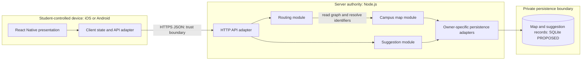
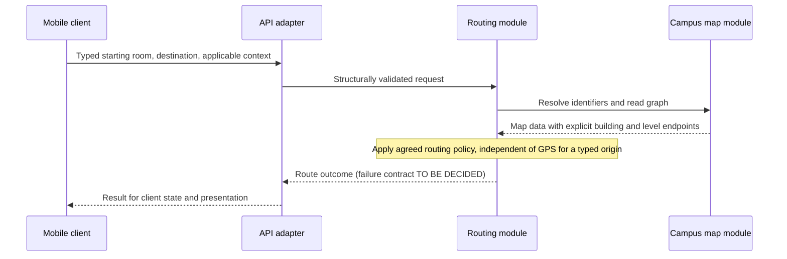

# Architecture

This document owns how the system is built. [REQUIREMENTS.md](REQUIREMENTS.md) owns behavior; [DESIGN.md](DESIGN.md) owns visual, interaction, and frontend constraints. No implementation is assumed. Technical recommendations are **PROPOSED**, missing facts are **UNKNOWN**, and pending decisions are **TO BE DECIDED**.

## Required Architecture Inputs

| Field | Input or decision |
| --- | --- |
| Requirements source | [REQUIREMENTS.md](REQUIREMENTS.md). |
| Design source | [DESIGN.md](DESIGN.md). |
| Target surfaces | **UNKNOWN** in REQUIREMENTS.md. Developer inputs confirm iOS and Android; this source gap remains explicit (AQ-1). |
| Runtime and deployment environment | Server runtime: **Node.js**, as supplied. Runtime version and deployment environment: **UNKNOWN** (AQ-1, AQ-2). |
| Server framework | **Node.js**, exactly as supplied. This names a runtime rather than a separate web framework; the intended HTTP framework choice is **TO BE DECIDED** (AQ-1). |
| Client framework(s) | **iOS and Android (React Native)**, as supplied. React Native version and supported OS versions: **UNKNOWN** (AQ-1, AQ-8). |
| API style and integration model | **PROPOSED:** synchronous JSON request/response over HTTPS. Mapping software is confirmed by the architecture notes. Map sources and positioning/weather integrations are **UNKNOWN**; integration selection is **TO BE DECIDED** (AQ-3, AQ-5). |
| Authentication and session model | Authentication, roles, and session requirements are **UNKNOWN**; whether sessions are needed and their model are **TO BE DECIDED** (OQ-10; AQ-9). |
| Data model and scale expectations | Required entities: campus, buildings, building levels, rooms, outdoor areas, walkways, elevators, routes, maps, map change suggestions, weather conditions. **PROPOSED:** relational records plus a routing graph. Dataset size, concurrency, traffic, and performance targets are **UNKNOWN** (AQ-2). |
| Security expectations | Requirements leave privacy and regulatory constraints **UNKNOWN**. Detailed controls and security-pack selection are deferred to `SECURITY.md`; select packs only for confirmed technology versions. No software versions have been supplied (AQ-9). |

## Architecture and Decisions

**PROPOSED:** a shared React Native application, one modular Node.js backend, and one durable relational store. Centralize map interpretation and routing policy so both clients receive consistent routes.

### Frameworks and API

**PROPOSED:** use Node.js's built-in HTTP server facilities for the limited request/response API, pending clarification of the supplied framework value (AQ-1). The transport adapter must handle request parsing and validation explicitly because this API is low-level. [Node.js HTTP documentation](https://nodejs.org/api/http.html#http).

**PROPOSED:** expose route requests and map suggestion submissions. Route requests carry a starting room, destination, and applicable routing context; the source of weather context is unresolved. Responses carry ordered route segments with building and level identifiers, plus map information required by the eventual presentation. Exact contracts, ambiguous-room outcomes, and unavailable-route responses are **TO BE DECIDED** (AQ-4, AQ-6, AQ-7).

**PROPOSED:** keep request state and presentation shared between iOS and Android, with platform and map-rendering details behind frontend adapters. Preserve DESIGN.md's permitted color pairs, opaque backing for essential map labels/graphics, persistent labels, intact room identifiers, scalable text, flat layout, and focus treatment. Map presentation and renderer selection remain **TO BE DECIDED**; a map SDK must not determine routing policy.

Two source mismatches need resolution (AQ-8). DESIGN.md's web-oriented `rem` and font-stack tokens need explicit native translation; React Native uses density-independent numeric dimensions. [React Native dimension documentation](https://reactnative.dev/docs/height-and-width). DESIGN.md also names WCAG 2.2 AA contrast thresholds while REQUIREMENTS.md leaves overall conformance open. Preserve the contrast constraints; broader conformance remains **TO BE DECIDED**.

### Persistence and Routing Model

**PROPOSED:** SQLite stores canonical map records and suggestions in separately owned tables, keeping persistence minimal. Suitability depends on the unknown workload and environment: SQLite permits only one writer at a time. [SQLite usage guidance](https://www.sqlite.org/whentouse.html#high_concurrency). Database and driver version selection is **TO BE DECIDED** (AQ-2).

The proposed model has these boundaries:

- **Campus map:** rooms belong to levels within buildings; outdoor areas and route junctions have stable identifiers. Graph edges represent indoor/outdoor paths, elevators, and inter-building walkways. Each walkway endpoint references its own building and level; connectivity and elevation cannot be inferred from floor labels (FR-3.1). Map provenance, geometry, completeness, and update authority are **UNKNOWN** (AQ-3).
- **Routing:** reads the map graph and derives routes. Indoor/outdoor classification supports FR-1.3, FR-1.4, and FR-4.1; elevator connections support FR-5.1. Offer qualifying routes where they exist. Cost definitions, constraint precedence, additional mobility attributes, and the search algorithm are **TO BE DECIDED** (AQ-4); unknown map attributes must not establish route suitability.
- **Suggestions:** persist submissions separately from canonical map data. Submission does not itself authorize a map edit. Fields and subsequent handling remain **TO BE DECIDED** (AQ-7).
- **Transient data:** keep route results, starting locations, mobility choices, and weather context request-scoped. Retention decisions remain in AQ-9.

### Authentication and Session Boundary

Authentication, including whether workflows allow anonymous access, is **TO BE DECIDED**. **PROPOSED:** if identity is required, verify it at the API boundary and enforce action permissions in the owning application module. Provider, session mechanism, credentials, and lifecycle depend on AQ-9; detailed controls belong in `SECURITY.md`.

## Components and Flows

Status describes requirement support, not implementation or technology approval: **SUPPORTED** means the responsibility follows from requirements; **PARTIALLY DEFINED** means policy or presentation is unresolved; **TO BE DECIDED** means the integration or mechanism is unselected. All component boundaries below are **PROPOSED**.

| Component | Status | Responsibility and business-rule enforcement | Data ownership | Requirement basis |
| --- | --- | --- | --- | --- |
| Mobile presentation and request state | PARTIALLY DEFINED | Capture route inputs and suggestions; render results under DESIGN.md; manual room entry cannot depend on GPS. Routing policy stays on the server. | Input drafts and displayed results only. | FR-1.1, FR-1.2, FR-2.1, FR-3.1, FR-6.1; unnumbered accessibility requirement. |
| API adapter | SUPPORTED | Parse requests, validate their structure, and dispatch to application modules; identity enforcement remains conditional on AQ-9. | Transport data only. | FR-1.1, FR-1.2, FR-6.1. |
| Campus map module | PARTIALLY DEFINED | Resolve room/destination identifiers; provide consistent graph connectivity and explicit building/level endpoints. Ambiguity policy remains open. | Canonical campus, building, level, room, outdoor-area, path, elevator, and map records. | FR-1.1, FR-1.2, FR-1.3, FR-1.4, FR-2.1, FR-3.1, FR-5.1. |
| Routing module | PARTIALLY DEFINED | Apply routing costs and weather/mobility rules; compute qualifying routes from map data. Priorities and failure outcomes remain open. | Derived route results and request context; read-only access to map data. | FR-1.1, FR-1.2, FR-1.3, FR-1.4, FR-2.1, FR-3.1, FR-4.1, FR-5.1. |
| Suggestion module | PARTIALLY DEFINED | Validate and accept suggestions under the eventual submission contract; cannot publish map changes. | Submitted suggestions. | FR-6.1. |
| Persistence adapters | SUPPORTED | Translate owner-defined storage operations into database access; enforce record integrity, not routing policy. | Physical persistence only; logical ownership stays with map and suggestion modules. | FR-1.1, FR-1.2, FR-3.1, FR-6.1. |
| Weather and positioning integration boundaries | TO BE DECIDED | Normalize inputs if integrations are selected. Weather determination is unresolved; GPS cannot be required for a typed-room origin. | External observations only; provider and retention are unresolved. | FR-4.1, FR-2.1; GPS mentioned in requirements inputs. |

### Main Data Flows and Trust Boundaries

1. **Route request:** student enters the starting room and destination; client state sends the request to the API. The routing module asks the map module to resolve identifiers and read the graph, then applies the agreed route policy. The result returns through the API into client state and presentation. Both endpoints of cross-building level transitions remain explicit throughout. FR-2.1 requires no GPS dependency; it does not establish offline operation.
2. **Weather and mobility:** the routing module uses the established rain context and the student's elevator need to find the required qualifying routes. Weather determination, competing priorities, and unsatisfied constraints remain **TO BE DECIDED** (AQ-4, AQ-5). An unmet constraint must not be silently represented as satisfied.
3. **Suggestion submission:** client draft crosses the API boundary into the suggestion module, which validates and persists it through its storage interface. **PROPOSED:** acknowledge acceptance only after persistence succeeds. This flow ends at submission; review and incorporation into the map are unresolved (AQ-7).

The student-controlled device is outside server authority: client state cannot authorize actions or establish map truth. **PROPOSED:** the API validates transport inputs; owning modules validate identifiers, connectivity, route suitability, and eventual access permissions. Persistence is reachable only through owner-specific adapters. Future map, weather, or positioning inputs cross an external-data boundary and must be normalized before domain use. Their selection and trust policy remain open; privacy and detailed controls belong in `SECURITY.md`.

## Dependency Rules

These **PROPOSED** rules define permitted directions and ownership:

- **DR-1:** Mobile presentation sends actions to client state/use cases, which call the client API adapter. Responses update state before rendering. Presentation must not query persistence or implement authoritative routing policy.
- **DR-2:** Server HTTP adapters call application modules; application modules call domain policy and owner-defined data interfaces. Domain rules must not depend on React Native, HTTP framework APIs, SQL, or mapping/weather vendor SDKs.
- **DR-3:** Routing may read the campus map through the map module's interface. The map module must not depend on routing. The suggestion module owns submission handling and must not write canonical map records or depend on routing.
- **DR-4:** Only the campus map module owns canonical map writes; only the suggestion module owns suggestion writes. Each accesses storage through its own interface. Persistence adapters implement those interfaces and cannot call application workflows or read another owner's tables on their behalf.
- **DR-5:** Platform, database, and eventual external-service adapters implement interfaces defined by their consuming modules. Vendor data is translated at these boundaries; business policy stays in the domain. Assembly may wire adapters to interfaces without introducing reverse module dependencies.
- **DR-6:** Requests flow from presentation through application logic to domain/data interfaces; results return along that call chain. Return values do not create reverse dependencies. No module dependency cycle or shared mutable store bypassing a data owner is permitted.

## Open Questions

- **AQ-1 — Input reconciliation and versions:** iOS and Android are confirmed developer choices but absent from REQUIREMENTS.md and unresolved in DESIGN.md. Source alignment is **TO BE DECIDED**. Does the supplied server-framework value mean built-in Node.js HTTP facilities or an additional framework? Node.js and React Native versions are **UNKNOWN**; version selection is **TO BE DECIDED**.
- **AQ-2 — Environment and capacity:** Deployment environment, map size, concurrent requests/writes, latency, and availability expectations are **UNKNOWN**. Database/driver selection and suitability of request-time graph computation are **TO BE DECIDED** against those facts.
- **AQ-3 — Authoritative map data:** Source, format, coordinate/level conventions, permitted use, completeness, freshness, and update authority are **UNKNOWN**. Data acquisition, validation, and update mechanisms are **TO BE DECIDED**; suggestion submission does not define them.
- **AQ-4 — Routing policy:** Distance/cost metric, rain-versus-mobility precedence, safer-path meaning, additional mobility needs, and unavailable-route behavior are **TO BE DECIDED** (OQ-1, OQ-3, OQ-5). These determine graph attributes, solver selection, and result contracts.
- **AQ-5 — Weather, location, and connectivity:** Weather source and triggers beyond rain, positioning scope/provider, and connectivity expectations are **UNKNOWN** (OQ-2). Integration mechanisms are **TO BE DECIDED**; manual room entry remains independent of GPS (FR-2.1).
- **AQ-6 — Identifier and route contracts:** Unknown/ambiguous room handling and cross-building level notation are **TO BE DECIDED** (OQ-4, OQ-9; DQ-3). Canonical identifiers and the response representation must support those decisions.
- **AQ-7 — Suggestion lifecycle:** Required payload, validation rules, attribution, post-submission behavior, and responsibility for subsequent map changes are **TO BE DECIDED** (OQ-8; DQ-6). No moderation or publishing component is established by FR-6.1.
- **AQ-8 — Native presentation and accessibility:** Minimum OS/device support and languages are **UNKNOWN**. Native token conversion, route/map renderer, level notation, visual aids, mobility controls, and control/focus dimensions are **TO BE DECIDED** (DQ-2, DQ-3, DQ-4, DQ-5). Reconcile DESIGN.md's WCAG 2.2 AA contrast wording with the unresolved overall conformance target (OQ-6); proposed brand adoption remains DQ-1.
- **AQ-9 — Identity and security:** Authentication, action permissions, session needs, privacy/regulatory obligations, and retention of locations, mobility choices, or suggestions are **UNKNOWN** (OQ-10). Policy and enforcement details are **TO BE DECIDED** in `SECURITY.md`; version-specific packs require confirmed versions.
- **AQ-10 — Undefined action:** The meaning of "mark the app" is **UNKNOWN** (OQ-7). Any architectural consequence is **TO BE DECIDED** after behavior is defined.

## Diagrams

The **PROPOSED** component diagram shows logical authority and data-access boundaries, not deployment topology. Arrows show request/access direction; responses return along the same path. Unselected weather and positioning integrations are omitted.

The **PROPOSED** route flow highlights server-owned resolution and policy; error semantics remain open.

