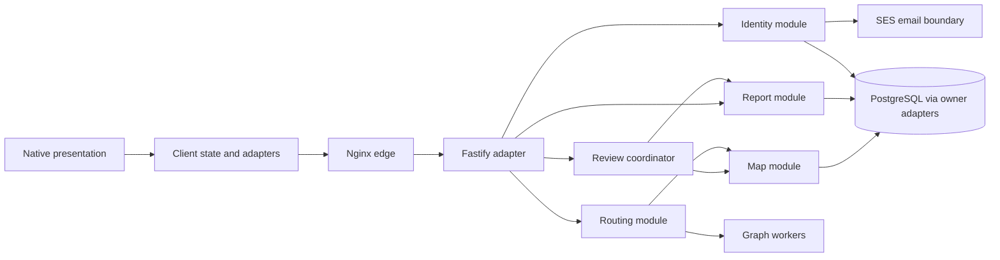

# Architecture

This file owns technology, components, interfaces, data flow and structural trust boundaries. Product semantics and failure behavior are in [REQUIREMENTS.md](REQUIREMENTS.md), visual conventions in [DESIGN.md](DESIGN.md), and all security controls in [SECURITY.md](SECURITY.md). Decisions below are selected implementation targets; this repository has no application implementation yet.

## Required Architecture Inputs

| Input | Authoritative decision |
| --- | --- |
| Product requirements and acceptance | [REQUIREMENTS.md](REQUIREMENTS.md) |
| Presentation and accessibility | [DESIGN.md](DESIGN.md) |
| Client/server stack | AQ-1 |
| Hosting, persistence and capacity | AQ-2 |
| Map provenance and geometry | AQ-3 |
| Routing model | AQ-4 |
| Location, weather and connectivity adapters | AQ-5 |
| Route and report interfaces | AQ-6, AQ-7 |
| Native toolchain and renderer | AQ-8 |
| Identity implementation | AQ-9 |
| Components and dependency rules | AQ-11, DR-1–DR-6 |
| Security enforcement | [SECURITY.md](SECURITY.md) |

## Decisions

### AQ-1

**RESOLVED — stack.** Use Node.js 24 LTS, Fastify 5.12, React Native 0.87, React 19.2, TypeScript 6.0, and Zod 4. Initial reviewed baselines are Node.js 24.21.0, React Native 0.87.1, React 19.2.3, and TypeScript 6.0.3. Exact installed patches belong in the generated lockfile; maintenance follows [SC-014](SECURITY.md#sc-014). This selects version lines without claiming an installation or build has happened.

Fastify supplies the HTTP lifecycle and plugin model instead of handwritten Node HTTP dispatch. Zod supplies shared runtime contracts. The native stack follows the [tagged React Native template](https://github.com/react-native-community/template/blob/0.87.1/template/package.json); the backend line is supported by the [Fastify LTS matrix](https://github.com/fastify/fastify/blob/main/docs/Reference/LTS.md) and [Node release schedule](https://github.com/nodejs/Release). TypeScript 7 is not selected merely because a security corpus includes it.

### AQ-2

**RESOLVED — hosting, scale and storage.** Deploy one API instance on an AWS EC2 Ubuntu 24.04 LTS VM in Frankfurt (`eu-central-1`), initially 2 vCPU and 4 GiB RAM. Use the distribution-maintained Nginx package as the edge and systemd as the process supervisor. Use RDS PostgreSQL 17, initially single-AZ with 2 vCPU/4 GiB class capacity, and the JavaScript `pg` 8 driver with SQL migrations. No ORM, SQLite, Docker, Kubernetes or Redis in the first release. PostgreSQL supports concurrent review/account writes more directly than the earlier SQLite proposal; [its version policy](https://www.postgresql.org/support/versioning/) defines maintenance of the chosen line.

Capacity fixture: one campus, up to 100 buildings, 1,000 levels, 30,000 rooms, 100,000 graph vertices and 300,000 directed edges. Plan for 10,000 daily users, 1,000 concurrent clients, 25 route requests/second steady, 100/second for a 60-second burst, and five durable writes/second. These are design budgets, not measured campus facts. Performance and recovery acceptance are NFR-1–NFR-4. Route workers use an in-memory immutable graph revision; two worker threads and a bounded job queue isolate graph computation from the API event loop. Resource enforcement is SC-001.

Repository layout: `apps/mobile`, `apps/api`, `packages/contracts`, `packages/domain`, `data/maps`, `ops`, and `tests`. Contracts contain DTOs and runtime schemas; domain contains graph and policy logic without framework imports. Operational commands belong to AGENTS.md WQ-1.

### AQ-3

**RESOLVED — authoritative map pipeline.** The operator maintains an independently surveyed campus dataset with contributor permission under CC BY 4.0. University plans may be incorporated only with documented permission; no right to use an institutional plan is assumed. The first release uses no remote tile service, OSM import, geocoder or university-private floor plan. Actual surveys and permissions are release deliverables, not facts invented by this decision.

Store WGS84 coordinates for outdoor points and surveyed meter coordinates in a campus-local frame for indoor geometry, with a versioned transform between them. A level has an opaque stable ID, its building ID, display label and measured elevation; display labels do not imply physical connectivity. Map versions contain rooms, destinations, nodes, directed edges, geometry and provenance. Edge attributes include length, indoor classification, access class, stairs/ramp/elevator type, clearance width, slope, lighting evidence, closure state and observation timestamps. Absent survey measurements are explicit null data values; their product treatment is FR-5.3.

The map module imports a bounded local GeoJSON-plus-graph bundle, produces a validation report and stages a version. A moderator publishes through the review workflow; one transaction advances the active version pointer. Clients refresh the manifest on foregrounding and at 30-second intervals while online. Publication also swaps the worker graph atomically. Review elevator/closure evidence daily and survey attributes every 90 days; eligibility uses the freshness policy in FR-5.6. Import and publication controls belong to SC-009 and SC-010.

### AQ-4

**RESOLVED — solver.** Use Dijkstra on directed edges after applying the eligibility predicates defined by FR-1.6, FR-4.1–FR-4.4 and FR-5.1–FR-5.6. Cost is supplied by FR-1.5; break equal costs by lexicographic edge-ID sequence. Distances include measured vertical travel; do not derive them from floor-label arithmetic. Each request uses one immutable map revision. Compile routes into ordered segments referencing both endpoint levels. The solver returns an outcome union; product handling belongs to FR-1.7 and FR-1.8. There is no client-side route solver in this release.

### AQ-5

**RESOLVED — adapters.** Weather is a request-local selection with no weather vendor. Positioning uses a narrow native module over iOS Core Location and Android LocationManager; no indoor beacons, background service or third-party positioning SDK. The client maps a foreground fix to nearby outdoor graph nodes, then submits the confirmed node ID; raw device coordinates are not needed by the route API. The adapter implements the positioning outcome in FR-2.8. Location permissions and data handling are SC-002 and SC-008.

Cache the most recent public map bundle in the app's files; store its manifest and revision time beside it. Offline behavior is FR-8.3 and FR-8.4. The sole external transactional integration is Amazon SES in Frankfurt for authentication and account-lifecycle emails, invoked through AWS SDK for JavaScript v3. There are no user-supplied outbound destinations; enforcement belongs to SC-010. AWS resource names, DNS and sender identities are deployment configuration supplied by the operator, validated under SC-013 rather than fictitious values in this specification.

### AQ-6

**RESOLVED — API.** Use synchronous UTF-8 JSON request/response at `/v1` over the transport controlled by SC-001. Canonical entity IDs are opaque UUIDs. Room lookup uses a maintained alias index implementing FR-2.7.

| Interface | Request/response structure | Product contract |
| --- | --- | --- |
| `GET /v1/map/manifest` | Active revision, timestamp, coverage, attribution and bundle hash | NFR-8 |
| `GET /v1/map/versions/:id` | Geometry, display labels and public graph attributes; paginated by building/level | NFR-8 |
| `POST /v1/rooms/resolve` | `{query, buildingId?}` → resolved ID, candidate list, or no match | FR-2.2, FR-2.3 |
| `POST /v1/routes` | `{originId, destinationId, weather, indoor, mobility, wellLit}` → outcome union | FR-1.1–FR-5.6 |
| `POST /v1/auth/challenges` | `{email}` → challenge receipt | FR-7.6 |
| `POST /v1/auth/sessions` | `{challengeId, code}` → session DTO | FR-7.6 |
| `POST /v1/auth/refresh` | Refresh credential → replacement session DTO | FR-7.7 |
| `DELETE /v1/auth/session` | Current session → empty success | FR-7.7 |
| `GET /v1/account/export` | Authenticated request → export receipt/download when ready | FR-7.8 |
| `DELETE /v1/account` | Authenticated deletion → receipt | FR-7.8, FR-7.9 |

The route outcome union is `route`, `no_route`, or `invalid_input`. A route DTO contains `mapVersion`, `distanceMeters`, ordered segments, per-segment `from`/`to` building and level IDs, canonical labels, geometry and instruction keys. Contract schemas define `weather = none | rain | snow_ice | wind` and `mobility = standard | elevator | step_free`; display wording is owned by DESIGN.md. Responses use localization keys and structured parameters, not server-generated HTML.

Error envelopes contain `code`, optional field keys, and an opaque `requestId`. HTTP mapping: 400 invalid input, 401 unauthenticated, 403 forbidden, 404 resource not found, 409 conflict, 413 payload too large, 429 rate limited, and 503 unavailable; a valid no-route result is 200. Authentication-error enforcement is SC-012. Request budgets and validation enforcement are SC-001/SC-004.

### AQ-7

**RESOLVED — report interfaces and lifecycle.** `POST /v1/reports` receives `{category, location, description, observedAt}` and an `Idempotency-Key` header. `location` is the discriminated union `{kind: item, itemId}`, `{kind: point, buildingId, levelId, x, y}`, or `{kind: room, roomId}`. The report module assigns its UUID, owner and timestamps. `GET /v1/reports` lists the caller's reports; `GET /v1/reports/:id` returns its detail.

Moderation uses `GET /v1/moderation/reports`, `POST /v1/moderation/reports/:id/review` and `POST /v1/map/publications`. Review requests contain an expected report version, action and reason; publication contains an expected active map revision and staged version ID. The review coordinator calls report and map interfaces; the report module itself cannot write canonical map data. A transaction commits review outcome, publication pointer and audit event together when publication is requested. Concurrent stale versions return conflict. Behavioral states, receipts and retries are defined only by FR-6.6–FR-6.13; authorization and integrity enforcement are SC-007/SC-009.

### AQ-8

**RESOLVED — native build and renderer.** Product OS support is owned by FR-8.7. Use React Native's New Architecture and bundled Hermes, Community CLI 20.2, CocoaPods (not experimental SwiftPM), Xcode 26 with Swift 6.2 compiler in Swift 5 language mode, JDK 17, Kotlin 2.2.0, AGP 9.2.1, compile SDK/build tools 37 and target SDK 36. Preserve the tagged template's compatible Gradle wrapper. The [tagged Android versions](https://github.com/react/react-native/blob/v0.87.1/packages/react-native/gradle/libs.versions.toml) and [release notes](https://reactnative.dev/blog/2026/08/11/react-native-0.87) support this baseline; store-policy and native build checks remain implementation evidence, not claimed results.

Render surveyed floor geometry with `react-native-svg` 15 (minimum 15.13) using native vector primitives; no browser application, SSR or React Server Components; sink restrictions are owned by SC-011. The [renderer compatibility table](https://github.com/software-mansion/react-native-svg) covers the selected React Native range; both native builds must still be tested. Keep map drawing behind `MapRenderer` and location/credential operations behind narrow platform adapters. Token translation and rendering presentation belong to DQ-2/DQ-3; sink controls belong to SC-011.

### AQ-9

**RESOLVED — identity.** A dedicated identity module issues email challenges through SES and stores accounts and opaque sessions in PostgreSQL. The mobile app calls a narrow native credential adapter governed by SC-002. No passwords, university SSO, student-ID integration, passkeys, JWTs or browser cookies in this release. Authentication policy and all credential generation, storage, expiry, retry and recovery controls are authored in SC-012; permitted actions are FR-7.1–FR-7.11.

Moderation uses a private operator CLI calling the same API interfaces from the management network. Role provisioning uses an operator-only command on the management host. No additional public admin frontend is required.

### AQ-10

**RESOLVED.** The previously ambiguous action is implemented by the report flow in AQ-7; its meaning is owned by [OQ-7](REQUIREMENTS.md#oq-7).

### AQ-11

**RESOLVED — components.** Adopt these boundaries and DR-1–DR-6. No component responsibility table grants access; controls are owned by SECURITY.md.

| Component | Responsibility | Owned data |
| --- | --- | --- |
| Mobile presentation and state | Inputs, drafts, results and platform adapters | Session-local presentation state and public map cache |
| API adapter | Transport DTO conversion and dispatch | No domain records |
| Identity module | Challenge/session/account lifecycle | Account, credential-verifier and role records |
| Map module | Lookup, imports, staged revisions and publication | Canonical map and revision records |
| Routing module | Graph filtering and Dijkstra jobs | Request-local derived results |
| Report module | Submission and review-state transitions | Reports and idempotency receipts |
| Review coordinator | Compose report and map operations | No independent store |
| Persistence adapters | Implement owner-specific interfaces and transaction context | No independent logical ownership |
| Worker pool | Compute against a pinned graph revision | Read-only graph snapshots |
| Operations jobs | Scheduled retention, backup and export orchestration | Job metadata through owner interfaces |

## Dependency Rules

- **DR-1:** Presentation calls client state/use cases, then the API adapter; responses update state before rendering. Presentation has no persistence or authoritative routing dependency.
- **DR-2:** Server adapters call application modules, which call domain policy and owner-defined data interfaces. Domain code imports no React Native, HTTP, SQL or vendor SDK APIs.
- **DR-3:** Routing reads map data through the map interface; the map module never calls routing. Reports call neither routing nor canonical-map writes; the review coordinator composes the two owning interfaces.
- **DR-4:** Each module owns its writes and exposes interfaces for reads. Storage adapters implement these interfaces and accept a coordinator-supplied transaction context; they never call workflows or bypass another owner's interface.
- **DR-5:** Platform, persistence and service adapters implement interfaces defined by their consumers and translate vendor data at entry. The composition root may wire implementations without reversing dependency direction.
- **DR-6:** Requests travel from presentation through application logic to domain/data interfaces; returned values do not reverse dependency direction. Module cycles and shared mutable stores bypassing ownership are forbidden.

## Data Flows and Trust Boundaries

The device is outside server authority. The edge terminates the public transport boundary; application modules own semantic processing; PostgreSQL and operations interfaces are private infrastructure. Each boundary's enforcement is specified in SECURITY.md.

1. Route inputs cross the device/edge boundary into AQ-6. The routing module resolves IDs through the map module, pins a graph version, submits a worker job and returns the outcome through the same interfaces.
2. Report inputs cross AQ-7 into the report transaction. A later moderator operation crosses the management boundary and invokes the review coordinator; publication changes the map manifest and worker revision.
3. Native positioning stays inside the client adapter until the confirmed map-node ID enters the route request. Weather is local request context, not an external observation.
4. Identity challenges cross the email boundary; session DTOs return to the credential adapter. Account, export and deletion jobs pass through the identity/report owners.

## Verification Dependencies

Implementation must demonstrate native builds, driver/transaction behavior, schema integration, transport controls and the REQUIREMENTS.md acceptance suite. No runtime compatibility test is claimed by this documentation change. The outstanding threat-model work is tracked only by [OD-015](SECURITY.md#od-015); it does not block these architecture decisions.
